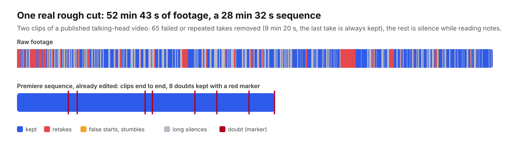

[English](README.md) | **Français**

# premiere-rough-cut

**Des skills Claude Code qui dérushent une vidéo face caméra directement dans Adobe Premiere Pro.** Les reprises, faux
départs, bafouillages et longs silences sont retirés, les doutes portent un marqueur rouge, les sous-titres sont
corrigés et l'habillage tombe sur le bon mot. Vous recevez une séquence Premiere modifiable, pas un MP4 : vous restez
le monteur.



*Une de mes vidéos (en français, deux rushs) : les rushs en haut, la séquence ouverte dans Premiere en bas. Rien n'a été
retouché à la main entre les deux.*

---

## Installer

Dans Claude Code :

```text
/plugin marketplace add ThomasHMD/premiere-rough-cut
/plugin install premiere-rough-cut@premiere-rough-cut
```

Puis demandez à Claude d'« installer premiere-rough-cut » : il lance le script d'installation, qui vérifie le Mac et
installe ce qui manque en demandant à chaque étape : ffmpeg, whisper.cpp et son modèle, quelques paquets Python, l'atelier
Remotion. Installation à la main, sans le système de plugins : [INSTALL.md](INSTALL.md).

**Il vous faut** : un Mac (testé sur Apple Silicon), Adobe Premiere Pro avec la transcription (panneau Texte, Transcription),
Claude Code, Homebrew, environ 5 Go de disque.

## Ce que ça fait

| Skill | Vous dites | Vous recevez |
|---|---|---|
| `rough-cut` | « dérushe ce rush » | `<rush>_Derush_v1.xml` : une séquence déjà montée (plans bout à bout, rien à fermer), les passages douteux gardés avec un marqueur rouge, et un rapport de chaque coupe |
| `subtitles` | « corrige les sous-titres » | le JSON de sous-titres de Premiere avec les bons mots, les noms propres écrits d'après votre script, la ponctuation, et des timings recalés sur l'audio ; à réimporter tel quel |
| `overlays` | « habille la vidéo » | un XML Premiere avec scènes, bas de titre, photos, GIF, démos de sites et bruitages sur leurs propres pistes, chacun calé sur le mot qu'il illustre |
| `motion-design` | (appelé par `overlays`) | l'atelier Remotion : tout ce qui bouge ou qui sonne, rendu en local, sans image ni vidéo générée par IA |

Lancez une skill directement avec `/premiere-rough-cut:rough-cut` (et ainsi de suite), ou décrivez simplement ce que vous
voulez.

## L'idée qui fait marcher le tout : deux transcriptions

La transcription de Premiere et whisper se trompent de façon opposée, alors le kit utilise les deux.

- **Premiere** garde tout ce qui a été dit, chaque reprise et chaque bafouillage, avec des timings de mots qui restent
  justes après de longs silences. C'est la source du **moment**.
- **whisper** écrit mieux les mots et les noms propres, mais son décodeur prend une phrase redite pour une hallucination
  et n'en garde qu'une : les reprises disparaissent de sa transcription. C'est un **second avis sur les mots**.

Le kit lit la transcription de Premiere directement dans votre `.prproj` (rien à exporter), la recale sur l'audio et la
compare avec whisper et avec votre script. Puis Claude tranche, avec des règles fixes : une phrase répétée garde sa
**dernière** prise, un bafouillage garde son plus long passage propre, et tout ce qui est incertain est **marqué, jamais
coupé** (ajouter une coupe prend un clic, retrouver une phrase manquante prend un temps fou). Détail : [docs/how-it-works.md](docs/how-it-works.md).

## Une vidéo, de bout en bout

1. Écrivez un script (n'importe quel format). Tournez. Redites la phrase quand vous la ratez : la dernière prise gagne.
2. Dans Premiere : importez le rush, **Transcrire**, enregistrez le projet.
3. Claude : le dérush. Importez le XML (**Fichier > Importer**), vérifiez les marqueurs rouges.
4. Claude : le plan d'habillage, vous l'approuvez, Claude fait le rendu et place tout, vous importez le second XML.
5. Claude : les sous-titres. Finissez, exportez.

Le déroulé complet, avec ce qu'il faut vérifier à chaque étape : [WORKFLOW.md](WORKFLOW.md). Si vous confiez le kit à votre
propre Claude, dirigez-le d'abord vers [AGENTS.md](AGENTS.md).

## Langues

Les règles de coupe ne dépendent pas de la langue, les listes de mots si. `rough-cut` et `subtitles` lisent
`languages/<code>.json` (mots de remplissage, amorces de faux départ, typographie, hallucinations connues de whisper). Le
**français** est éprouvé sur de vraies vidéos. L'**anglais** est écrit d'après les mêmes règles et attend encore un vrai
tournage en anglais pour être confirmé. Ajouter une langue, c'est un fichier JSON :
[skills/rough-cut/references/languages.md](skills/rough-cut/references/languages.md). Les pull requests sont bienvenues.

## Bon à savoir

- Il monte des rushs **face caméra** : une personne qui lit ou improvise à partir de notes. Les interviews et le
  multicaméra ne sont pas couverts.
- Tout tourne en local. Deux clés d'API facultatives seulement (recherche d'images, recherche de GIF).
- Le kit démarre neutre (accent bleu, Inter et Source Serif 4, une palette sonore douce). Faites-le à votre image avant
  votre première vidéo : `motion-design` explique comment.
- Remotion, utilisé par l'atelier, est gratuit pour les particuliers et les entreprises de 3 personnes au plus ; les plus
  grandes entreprises ont besoin d'une [licence Remotion](https://www.remotion.pro/license).

## Licence

MIT pour le code et la documentation, voir [LICENSE](LICENSE). Les polices incluses sont sous licence SIL Open Font
License, détails dans [THIRD_PARTY_LICENSES.md](THIRD_PARTY_LICENSES.md).

Je suis Thomas Hammoudi, photographe et créateur de vidéos YouTube en français ([dev.thomashammoudi.com](https://dev.thomashammoudi.com)).
J'ai construit ce kit pour ma chaîne, où il divise par deux le temps que je passe à monter une vidéo, et je le partage tel quel.
