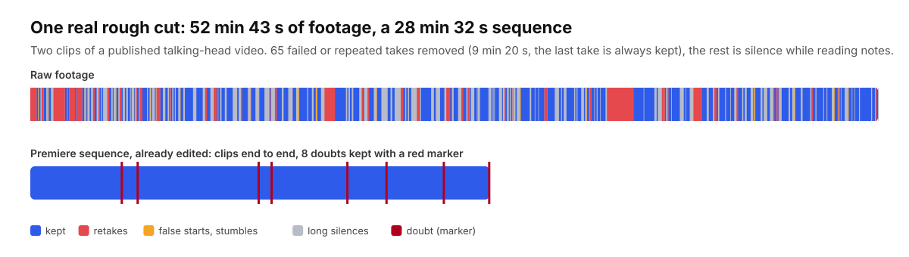

# premiere-rough-cut (en français)

**Des skills Claude Code qui dérushent une vidéo face caméra directement dans Adobe Premiere Pro.** Les reprises, faux
départs, bafouillages et longs silences sont retirés, les doutes portent un marqueur rouge, les sous-titres sont
corrigés et l'habillage tombe sur le bon mot. Vous recevez une séquence Premiere modifiable, pas un MP4 : vous restez
le monteur.



*Une de mes vidéos (deux rushs) : les rushs en haut, la séquence ouverte dans Premiere en bas, sans retouche entre les
deux.*

Le kit, ses skills et sa documentation sont en anglais ; Claude vous répond dans votre langue. Le français est la langue
la plus éprouvée : toutes les règles ont été réglées sur mes vidéos.

## Installer

Dans Claude Code :

```text
/plugin marketplace add ThomasHMD/premiere-rough-cut
/plugin install premiere-rough-cut@premiere-rough-cut
```

Puis demandez à Claude d'« installer premiere-rough-cut » : il lance le script d'installation, qui vérifie le Mac et
installe ce qui manque en demandant à chaque étape. Installation à la main : [INSTALL.md](INSTALL.md).

Il faut un Mac (testé sur Apple Silicon), Premiere Pro avec la transcription (panneau Texte), Claude Code, Homebrew et
environ 5 Go de disque.

## Ce que ça fait

| Skill | Vous dites | Vous recevez |
|---|---|---|
| `rough-cut` | « dérushe ce rush » | une séquence déjà montée (`<rush>_Derush_v1.xml`), les passages douteux gardés avec un marqueur rouge, et un rapport de chaque coupe |
| `subtitles` | « corrige les sous-titres » | le JSON de sous-titres de Premiere avec les bons mots, les noms propres de votre script, la ponctuation et la typographie française, et des timings recalés sur l'audio |
| `overlays` | « habille la vidéo » | un XML Premiere avec scènes, bas de titre, photos, GIF, démos de sites et bruitages sur leurs pistes, chacun calé sur le mot qu'il illustre |
| `motion-design` | (appelé par `overlays`) | l'atelier Remotion : tout ce qui bouge et tout ce qui sonne, rendu en local, sans image ni vidéo générée par IA |

## Le principe : deux transcriptions

Premiere garde tout ce qui a été dit, reprises comprises, avec des débuts de mots justes : c'est le **moment**. whisper
écrit mieux les mots et les noms propres, mais il fusionne les phrases redites (son décodeur prend une reprise pour une
hallucination) : c'est le **second avis sur les mots**. Le kit lit la transcription dans le `.prproj` (rien à exporter),
la recale sur l'audio, la croise avec whisper et le script, puis Claude tranche : on garde la **dernière** prise, le plus
long morceau d'un bafouillage, et le doute est **marqué, jamais coupé**. Détail : [docs/how-it-works.md](docs/how-it-works.md).

## Licence

MIT pour le code et la documentation ([LICENSE](LICENSE)). Polices sous licence SIL OFL
([THIRD_PARTY_LICENSES.md](THIRD_PARTY_LICENSES.md)). Remotion est gratuit jusqu'à 3 salariés, licence entreprise
au-delà.

Je suis Thomas Hammoudi, photographe et vidéaste ([dev.thomashammoudi.com](https://dev.thomashammoudi.com)). J'ai construit
ce kit pour ma chaîne, où il divise par deux le temps de dérush, et je le partage tel quel.
