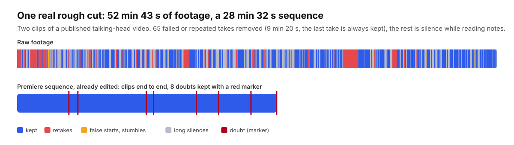

# premiere-rough-cut

**Claude Code skills that rough-cut talking-head footage straight into Adobe Premiere Pro.** Retakes, false starts,
stumbles and long silences are gone, doubts are flagged with a red marker, captions are fixed, and overlays land on the
exact word. You get an editable Premiere sequence, not a rendered MP4: you stay the editor.



*One of my own videos (French, two clips): the raw footage on top, the sequence Premiere opened below. Nothing was
touched by hand between the two.*

---

## Install

In Claude Code:

```text
/plugin marketplace add ThomasHMD/premiere-rough-cut
/plugin install premiere-rough-cut@premiere-rough-cut
```

Then ask Claude to "set up premiere-rough-cut". It runs the setup script, which checks your Mac and installs what is
missing, asking before each step: ffmpeg, whisper.cpp and its model, a few Python packages, the Remotion workshop.
Manual install without the plugin system: [INSTALL.md](INSTALL.md).

**You need**: a Mac (Apple Silicon tested), Adobe Premiere Pro with Speech to Text (Text panel, Transcript), Claude
Code, Homebrew, about 5 GB of disk.

## What it does

| Skill | You say | You get |
|---|---|---|
| `rough-cut` | "rough-cut this clip" | `<clip>_Derush_v1.xml`: a sequence already cut (clips end to end, nothing to close), the doubtful passages kept with a red marker, and a report of every cut |
| `subtitles` | "fix the captions" | Premiere's caption JSON with the right words, proper nouns spelled from your script, punctuation, and timings re-aligned on the audio; re-import as is |
| `overlays` | "add the overlays" | a Premiere XML with scenes, lower thirds, photos, GIFs, site demos and sound effects on their own tracks, each one timed on the word it illustrates |
| `motion-design` | (used by `overlays`) | the Remotion workshop: everything that moves or makes a sound, rendered locally, no AI-generated images or video |

Invoke a skill directly with `/premiere-rough-cut:rough-cut` (and so on), or just describe what you want.

## The idea that makes it work: two transcriptions

Premiere's own transcript and whisper fail in opposite ways, so the kit uses both.

- **Premiere** keeps everything that was said, every retake and every stumble, with word timings that stay accurate
  after long silences. It is the source of **timing**.
- **whisper** writes cleaner words and proper nouns, but its decoder takes a sentence said twice for a hallucination and
  keeps only one: retakes vanish from its transcript. It is a **second opinion on the words**.

The kit reads Premiere's transcript straight from your `.prproj` (no export), re-aligns it on the audio, and compares it
with whisper and with your script. Then Claude decides, with fixed rules: a repeated sentence keeps its **last** take, a
stumble keeps its longest clean run, and anything uncertain is **flagged, never cut** (adding a cut takes one click,
finding a missing sentence takes ages). Details: [docs/how-it-works.md](docs/how-it-works.md).

## A video, start to finish

1. Write a script (any format). Shoot. Say a sentence again when you miss it: the last take wins.
2. In Premiere: import the clip, **Transcribe**, save the project.
3. Claude: rough cut. Import the XML (**File > Import**), check the red markers.
4. Claude: overlay plan, you approve it, Claude renders and places everything, you import the second XML.
5. Claude: captions. Finish, export.

The full workflow, with what to check at each step: [WORKFLOW.md](WORKFLOW.md). If you hand the kit to your own Claude,
point it at [AGENTS.md](AGENTS.md) first.

## Languages

The cutting rules are language-independent; the word lists are not. `rough-cut` and `subtitles` read
`languages/<code>.json` (fillers, false-start phrases, typography, known whisper hallucinations). **French** is tested on
real videos. **English** is written from the same rules and still needs a real English shoot to confirm it. Adding a
language is one JSON file: [skills/rough-cut/references/languages.md](skills/rough-cut/references/languages.md). Pull
requests welcome.

## Good to know

- It edits **talking-head** footage: one speaker reading or improvising from notes. Interviews and multicam are not
  covered.
- Everything runs locally. Two optional API keys only (image search, GIF search).
- It starts neutral (blue accent, Inter and Source Serif 4, a soft sound palette). Make it yours before your first video:
  `motion-design` explains how.
- Remotion, used by the workshop, is free for individuals and companies of up to 3 people; larger companies need a
  [Remotion license](https://www.remotion.pro/license).

## License

MIT for the code and the documentation, see [LICENSE](LICENSE). Bundled fonts are under the SIL Open Font License,
details in [THIRD_PARTY_LICENSES.md](THIRD_PARTY_LICENSES.md).

I'm Thomas Hammoudi, a photographer who makes YouTube videos in French ([thomashammoudi.com](https://www.thomashammoudi.com)).
I built this for my own channel, where it halves the time I spend cutting a video, and I'm sharing it as it is.
