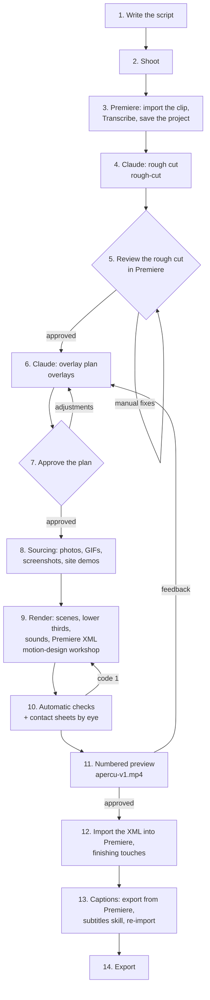

# From script to finished video

## The steps

**1. Write the script.** The text the person will say. It is used twice: in the rough cut (to know whether
a repetition is intended) and in the overlays and captions (correct spelling of proper names, ideas to
show). Free format (text, Markdown, Google Doc, Notion...).

**2. Shoot.** Talking-head. A botched sentence is simply said again: the last take is kept. No clapper or
slate needed.

**3. Premiere.** Import the clip, **Text > Transcribe**, then **save the project**. The transcript is now in
the `.prproj`: nothing to export.

**4. Rough cut (Claude, `rough-cut` skill).** Give Claude the clip path, the Premiere project and the
script. It reads Premiere's transcript (the right timing), cross-checks it with whisper and the script
(the right words), spots retakes, false starts, stumbles and silences, then delivers `<clip>_Derush_v1.xml`:
an **already-edited** sequence, doubts marked in red, and a report. Rule of thumb: a 20 min video comes
back at 15 min.

**5. Review the rough cut (user).** `File > Import` the XML, watch the sequence, settle the red markers,
remove the few cuts you dislike. Roughly a quarter of an hour per 20 min of footage. **Save the project**:
this corrected sequence is the reference from here on.

**6. Overlay plan (Claude, `overlays` skill).** It rereads the corrected sequence from the `.prproj`
(`timeline-from-prproj.py`), then proposes a plan: where to put a lower third, a quote, an animated scene, a
photo, a GIF, a site demo, anchored on **sentences** of the transcript (not on seconds: the plan survives a
re-sync). Template: `examples/plan-example.py`.

**7. Approve the plan (user).** Present the plan before rendering anything: what is shown, when, why.

**8. Sourcing (Claude).** Illustration photos (`source-illustrations.py`, image search if a key is
provided), GIFs (`gifs.py chercher`, choice sheet, then `gifs.py prendre`), page screenshots and mail
cards (`mail-cards.py`), site demos (`screencast-record.py`, one scenario per demo, anchored on spoken
words). Every chosen image is looked at before it is placed.

**9. Render (Claude, `motion-design` workshop).** `render-segments.py` has Remotion render each scene
(transparent MOVs for overlays, MP4 for full-screen), places the palette's sound effects on their tracks,
then writes the Premiere XML: V1 holds the footage, V2 b-rolls and demos, V3 photos, lower thirds and scenes
above them, sounds on A3 and up. Nothing is baked in: everything stays editable in Premiere.

**10. Checks.** The chain in `overlays/SKILL.md` ("Full chain"): word drift, face flashes between two
blocks, block holding, demo camera, readable proofs, render edges, plus the text checks
(`controle-texte.py`), the visual check (`montre.py`) and the free-zone check (`zone_libre.py`). A code 1
blocks. Then the contact sheets (frames around each cut, every hard-hit word captioned with the spoken
word): read them one by one.

**11. Preview.** `preview-sequence.py` builds an MP4 of the full sequence (`apercu-v1.mp4`). The user's
feedback goes back to step 6; each new preview gets a new number.

**12. Finishing touches (user).** Import the XML into the Premiere project, adjust what needs it (a
quieter sound, a duration), mix.

**13. Captions.** Export the captions from Premiere as JSON, give them to the `subtitles` skill (with the
video, and the script if possible): it re-transcribes locally, fixes the words, realigns the timings and
returns a JSON that Premiere imports as is.

**14. Export.**

## Fully animated video (no shoot)

Intro, outro, credits, voice-over explainer: go straight to the `motion-design` skill ("Pipeline for a
whole motion-design video"): frame it, animate in code, voice-over recorded by the user, music composed in
Python (`music/example_pad.py` as a model), sound effects, mix at the target volume, final MP4.

## What to plan for the first time

- Install the stack (`INSTALL.md`).
- Set the brand and the sound palette (`AGENTS.md`, "Before the first video").
- Make a short first video to tune the overlay level and the sound-effect volume.
