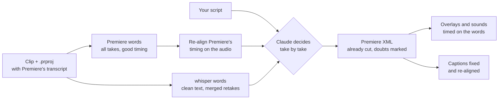

# How it works

This page explains the ideas behind the kit, for a person. The step-by-step instructions for Claude live in each skill's
`SKILL.md`.

## 1. Two transcriptions that fail in opposite ways

A talking-head shoot is full of retakes: you miss a sentence, you say it again, sometimes three times. To cut them you
need to know exactly what was said and when. Neither transcript tells you on its own.

- **Premiere's Speech to Text** keeps every word that was said, retakes and stumbles included, and its word start times
  stay accurate even after a long silence. Its spelling of names is often wrong.
- **whisper** (large-v3-turbo, run locally through whisper.cpp) writes much cleaner text and gets most proper nouns
  right. But its decoder has a guard against hallucinated loops: a sentence said twice in a row looks like one, so it
  keeps a single copy. On a shoot full of retakes, that silently erases the very thing you want to find. Turning the
  guard down only recovers part of them, and its timestamps drift after long silences.

So the kit uses Premiere for **when** and whisper plus your script for **what**. whisper is never used for cut points.

## 2. Reading the transcript out of the project

After you click Transcribe and save, the transcript is stored inside the `.prproj` (a gzipped XML). The kit reads it
from there (`extract_prproj_transcript.py`): nothing to export, nothing to copy and paste.

## 3. Re-aligning on the audio

On some clips Premiere's word times slowly drift late (by up to about 2 seconds at the end of a 30-minute clip).
`calibrate_premiere_times.py` measures the offset window by window, by cross-correlating the transcript's speech
activity with the audio, and corrects it. When there is no drift it changes nothing. Without this step, the silence
detector would report dozens of "suspicious noises" that are only misplaced words.

## 4. Choosing the takes

Claude reads the aligned transcript, whisper's version and your script side by side, and applies fixed rules:

- a sentence said several times keeps its **last** take (you said it again because the previous one was wrong);
- a stumble keeps the **longest clean run** of words;
- a word doubled by accident ("the the") is cut; an orphan connector left before a cut silence ("And...") goes with it;
- an aside that is not in the script ("ok, again", "is it recording?") is cut;
- any island shorter than 2 seconds left between two cuts is **listened to** (`hear.py`), never judged on the text;
- when in doubt, the passage is **kept and flagged**. Adding a cut in Premiere takes one click; finding a sentence that
  was wrongly removed takes ages.

Fillers ("um"), false-start phrases and known whisper hallucinations come from `languages/<code>.json`, so the rules work
in any language that has a file.

## 5. A sequence, not a list of cuts

The output is a Final Cut Pro 7 XML (XMEML), which Premiere imports natively (**File > Import**). The kept parts are
placed end to end: the sequence is already edited, with no gaps to close and no disabled clips to delete. Each doubt is a
red sequence marker whose comment says what is doubtful and why. Your original clip is never modified: the XML only
references it.

A report lists every cut (where it was in the clip, where it lands in the sequence, why), every doubt, and what was kept
on purpose.

## 6. Overlays timed on the words

Once you have approved the cut, `overlays` reads the final sequence back from the `.prproj` and maps every word to its
time in the edit. Each overlay (a quote, a lower third, a photo, a GIF, a site demo, a sound effect) is anchored to a
word, rendered by the Remotion workshop, and placed on its own track. Automatic checks run before delivery: nothing
covers the speaker's face, nothing hides an object the speaker shows to the camera, no text overflows its box, no
overlay is on screen too briefly to be read.

## 7. Captions

`subtitles` starts from the caption JSON that Premiere exports, transcribes the audio again with whisper, fixes proper
nouns from your script, restores punctuation and typography, then re-aligns every word on the audio with a forced
aligner. The result keeps Premiere's exact format, so it imports back as is.
